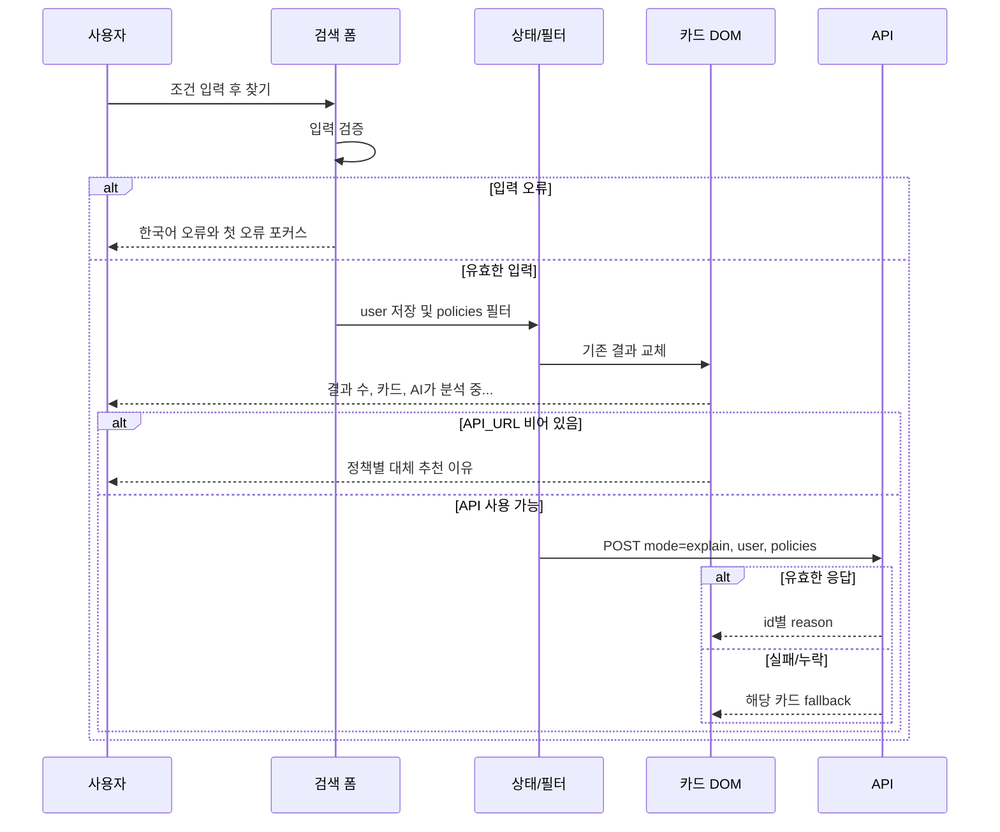
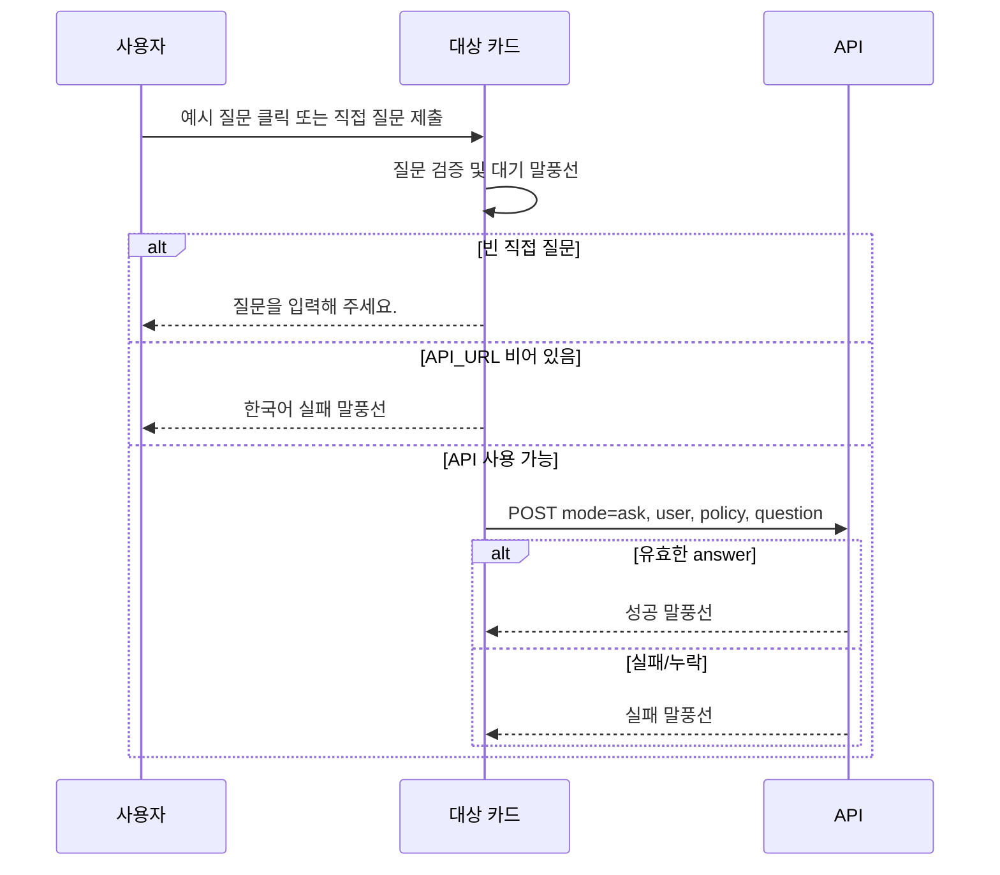

# Design Document

## Overview

`youth-benefit-frontend`는 청년 사용자가 입력한 나이, 지역, 소득, 취업 상태, 주거 형태를 기준으로 정책을 브라우저에서 필터링하고, 정책별 추천 이유와 질의응답을 제공하는 모바일 우선 단일 페이지 프론트엔드다.

구현 산출물은 `frontend/index.html` 하나뿐이다. HTML 구조, CSS, JavaScript를 이 파일에 통합한다. 런타임 정책 데이터는 `./policies.json`에서 읽되 실패 시 파일 안에 정의한 정확히 3개의 샘플 정책을 사용한다. 추천 이유와 질문 기능은 동일한 `API_URL`에 모드가 다른 JSON POST 요청을 보내며, URL 미설정 또는 오류 시 한국어 대체 문구를 표시한다.

### 1.1 설계 목표

- 다섯 사용자 조건을 모두 만족하는 정책만 표시한다.
- 정책 파일이나 API가 실패해도 입력과 로컬 검색은 계속 동작한다.
- 사용자 입력, 정책 데이터, API 응답을 실행 가능한 HTML로 해석하지 않는다.
- 키보드와 보조 기술만으로 전체 흐름을 사용할 수 있게 한다.
- 외부 런타임 의존성 없이 해커톤 MVP 범위를 유지한다.

### 1.2 범위와 변경 경계

- 수정 대상: `frontend/index.html`만 해당한다.
- 본 설계 문서 작성 단계에서는 실제 앱 코드를 수정하지 않는다.
- 구현 단계에서도 `frontend/policies.json`과 `lambda/handler.py`를 수정하지 않는다.
- Google Fonts의 Noto Sans KR 링크 외에는 외부 CSS·JavaScript 라이브러리를 사용하지 않는다.
- 로그인, 데이터베이스, 실제 알림 등록·저장·전송은 구현하지 않는다.

**관련 요구사항:** 1.1, 1.4, 8.2, 9.5

## Architecture

### 2.1 단일 파일 배치

`frontend/index.html` 내부 순서는 다음과 같다.

1. `<!doctype html>`과 `<html lang="ko">`
2. `<head>`의 메타데이터, viewport, 정확한 Google Fonts `<link>`, 내장 `<style>`
3. `<body>`의 헤더, `<main>`, 검색 `<form>`, 결과 영역, 토스트 라이브 영역
4. `</body>` 직전의 단일 `<script>`

`<script>`의 첫 JavaScript 선언은 공백과 따옴표를 포함해 정확히 다음과 같아야 한다.

```js
const API_URL = "";
```

이 선언 앞에는 다른 선언이나 실행문을 두지 않는다. 이후에 `SAMPLE_POLICIES`, 상태, DOM 참조, 함수, 이벤트 연결, 초기화 호출을 순서대로 둔다. 스크립트가 문서 끝에 있으므로 별도 `DOMContentLoaded` 대기 없이 마지막에 `initialize()`를 호출할 수 있다.

**관련 요구사항:** 1.1, 1.2, 1.3, 10.2, 10.3

### 2.2 논리 계층

단일 파일 안에서도 책임을 다음 함수 계층으로 분리한다.

| 계층 | 책임 | 주요 함수 |
|---|---|---|
| 초기화 | DOM 참조, 이벤트 연결, 정책 로드 | `initialize`, `loadPolicies`, `bindEvents` |
| 입력 | 폼 값 읽기와 한국어 검증 | `readAndValidateUser`, `showFormErrors`, `clearFormErrors` |
| 도메인 | 순수 정책 매칭과 D-day 계산 | `matchesPolicy`, `filterPolicies`, `calculateDday` |
| 렌더링 | 결과 요약·카드·이유·답변을 안전한 DOM으로 생성 | `renderResults`, `createPolicyCard`, `setReason`, `setAnswerState` |
| 네트워크 | explain/ask JSON POST와 응답 검증 | `requestExplanations`, `requestAnswer` |
| 상호작용 | 결과 영역 이벤트 위임과 토스트 | `handleResultsClick`, `handleResultsSubmit`, `showToast` |

도메인 함수는 DOM이나 네트워크에 의존하지 않도록 해 경계값을 독립적으로 검증할 수 있게 한다.

## Components and Interfaces

### 3.1 시맨틱 DOM 개요

```text
body
├─ header
│  ├─ pill 형태 보조 문구
│  └─ h1 + 강조 텍스트
├─ main
│  ├─ section[aria-labelledby="search-title"]
│  │  ├─ h2#search-title
│  │  └─ form#search-form
│  │     ├─ label + input#age[type=number]
│  │     ├─ label + select#region
│  │     ├─ label + input#income[type=number] + 단위 안내
│  │     ├─ label + select#employment
│  │     ├─ label + select#housing
│  │     ├─ 오류 요약[role=alert]
│  │     └─ button[type=submit]
│  └─ section#results[aria-labelledby="results-title"]
│     ├─ h2#results-title
│     ├─ p#result-summary[role=status][aria-live=polite]
│     └─ div#policy-list
│        └─ article 정책 카드들
└─ div#toast[role=status][aria-live=polite][aria-atomic=true]
```

각 정책 카드는 다음 요소를 가진다.

- 정책명을 담은 `h3`
- 혜택 텍스트
- 마감일과 텍스트가 함께 있는 D-day 배지
- 안전한 URL일 때만 생성되는 정책 링크
- 추천 이유 영역
- 서로 다른 예시 질문 `button` 2개
- 고유한 `label`이 연결된 질문 `input`과 전송 `button`을 포함한 카드별 `form`
- 카드별 답변 라이브 영역
- 알림 신청 `button`

카드의 질문 입력 `id`는 신뢰할 수 없는 정책 ID 대신 렌더링 배열 인덱스로 만든다. 예: `question-0`. 모든 동적 값은 `textContent` 또는 `document.createTextNode`로 넣는다.

### 3.2 입력 사양과 검증

| 필드 | 컨트롤 | 허용 값/제약 | 오류 예시 |
|---|---|---|---|
| 나이 | `input type="number"` | 필수, 유한한 정수, 0 이상 | `나이를 올바르게 입력해 주세요.` |
| 지역 | `select` | 서울, 경기, 인천, 부산, 기타 중 하나 | `지역을 선택해 주세요.` |
| 소득 | `input type="number"` | 필수, 유한한 수, 0 이상, 만원 단위 | `소득을 올바르게 입력해 주세요.` |
| 취업 상태 | `select` | 재직, 구직, 학생 중 하나 | `취업 상태를 선택해 주세요.` |
| 주거 형태 | `select` | 월세, 전세, 자가, 부모님집 중 하나 | `주거 형태를 선택해 주세요.` |

폼 제출 시 `readAndValidateUser()`가 문자열을 읽고 숫자를 변환한 뒤 허용 집합과 범위를 검사한다. 오류가 있으면 검색·렌더링·API 호출을 하지 않고 각 필드에 `aria-invalid="true"`와 오류 설명 연결을 적용하며, 오류 요약을 한국어로 표시하고 첫 오류 필드로 포커스를 옮긴다. 유효한 경우 오류 상태를 지우고 정규화한 `user` 객체를 반환한다.

모든 컨트롤은 명시적인 `<label for>`를 사용한다. 버튼은 네이티브 `button` 요소를 사용하고, 질문 입력의 Enter 제출을 지원한다. 모든 상호작용 요소에 `:focus-visible` 윤곽선을 제공한다.

**관련 요구사항:** 3.1–3.8, 10.1, 10.3, 10.7

## Data Models

### 4.1 사용자 모델

```js
{
  age: Number,
  region: "서울" | "경기" | "인천" | "부산" | "기타",
  income: Number, // 만원
  employment: "재직" | "구직" | "학생",
  housing: "월세" | "전세" | "자가" | "부모님집"
}
```

### 4.2 정책 모델

```js
{
  id: String,
  name: String,
  minAge: Number,
  maxAge: Number,
  regions: String[],
  maxIncome: Number | null,
  employment: String[],
  housing: String[],
  benefit: String,
  deadline: String, // YYYY-MM-DD
  url: String,
  reason?: String
}
```

외부 JSON은 비어 있지 않은 배열이면 요구사항에 따라 그대로 정책 목록으로 채택한다. 다만 개별 값은 신뢰하지 않는다. 필터 함수는 숫자와 배열을 방어적으로 확인하여 잘못된 객체를 불일치로 처리하고, 렌더러는 누락 텍스트에 한국어 기본값을 사용한다. 이 방어 처리는 비어 있지 않은 정상 배열을 샘플로 바꾸지 않으면서 처리되지 않은 예외를 막는다.

### 4.3 `SAMPLE_POLICIES`

스크립트에는 정확히 3개 객체가 있는 상수를 둔다. 각 객체는 카드와 필터에 필요한 모든 필드를 포함한다. 구현 시 사용할 구체적인 형태는 다음과 같다.

```js
const SAMPLE_POLICIES = [
  {
    id: "sample-youth-rent",
    name: "청년 월세 지원",
    minAge: 19,
    maxAge: 34,
    regions: ["전국"],
    maxIncome: 3500,
    employment: ["재직", "구직", "학생"],
    housing: ["월세"],
    benefit: "월세 부담을 줄이는 주거비 지원",
    deadline: "2026-12-31",
    url: "https://www.youthcenter.go.kr/",
    reason: "청년 월세 거주자를 위한 주거비 지원 조건에 해당합니다."
  },
  {
    id: "sample-job-support",
    name: "청년 취업 준비 지원",
    minAge: 18,
    maxAge: 39,
    regions: ["서울", "경기", "인천", "부산", "기타"],
    maxIncome: 4200,
    employment: ["구직", "학생"],
    housing: ["월세", "전세", "자가", "부모님집"],
    benefit: "취업 준비 활동비와 상담 지원",
    deadline: "2026-09-30",
    url: "https://www.work24.go.kr/"
  },
  {
    id: "sample-housing-loan",
    name: "청년 전세자금 지원",
    minAge: 19,
    maxAge: 39,
    regions: ["전국"],
    maxIncome: null,
    employment: ["재직", "구직", "학생"],
    housing: ["전세"],
    benefit: "전세 보증금 대출 이자 부담 완화",
    deadline: "2026-08-31",
    url: "https://nhuf.molit.go.kr/"
  }
];
```

**관련 요구사항:** 2.2, 2.3

### 4.4 애플리케이션 상태

```js
const state = {
  user: null,
  policies: SAMPLE_POLICIES.slice(),
  matchedPolicies: []
};
```

- `user`: 마지막으로 유효하게 제출된 사용자 조건이다.
- `policies`: 초기에는 샘플 복사본이므로 데이터 요청 중에도 검색할 수 있다. 로드 성공 시 외부 배열로, 실패 시 새 샘플 복사본으로 교체한다.
- `matchedPolicies`: 마지막 검색 결과다. 검색마다 새 배열로 교체한다.

비동기 경합을 제어하기 위한 UI 내부 값은 도메인 상태와 분리한다.

- `searchRevision`: 유효 검색마다 증가한다. 이전 explain 응답은 현재 revision과 다르면 폐기한다.
- `answerRevisions: Map<number, number>`: 카드 인덱스별 최신 질문만 답변 영역을 갱신하게 한다.
- `cardViews`: 현재 렌더링된 카드의 정책 인덱스, 이유 노드, 답변 노드를 보관한다. 신뢰할 수 없는 ID를 CSS 선택자로 만들지 않는다.
- `toastTimer`: 연속 알림 클릭 시 기존 자동 숨김 타이머를 취소하고 다시 시작한다.

**관련 요구사항:** 4.8, 6.4, 7.11

## 5. 초기화와 정책 데이터 로드

### 5.1 초기화 순서

```text
initialize()
  ├─ cacheDomReferences()
  ├─ bindEvents()
  └─ await loadPolicies()
```

`bindEvents()`를 먼저 실행하고 `state.policies`를 샘플로 초기화하므로 네트워크 지연이나 실패가 폼 사용을 막지 않는다.

### 5.2 로드 알고리즘

`loadPolicies()`는 반드시 `fetch("./policies.json")`를 호출한다.

```text
try
  response = await fetch("./policies.json")
  response.ok가 아니면 실패
  data = await response.json()
  data가 배열이 아니거나 길이가 0이면 실패
  state.policies = data
catch
  state.policies = SAMPLE_POLICIES.slice()
```

실패 범위는 네트워크 거부, 404 등 비정상 HTTP, JSON 파싱 실패, 비배열 결과, 빈 배열을 모두 포함한다. 사용자 화면에는 기술 오류나 예외 문자열을 노출하지 않는다. 필요하면 `샘플 정책으로 검색할 수 있어요.`처럼 고정된 한국어 상태만 표시한다. 로드 실패는 throw로 상위 초기화를 중단시키지 않는다.

**관련 요구사항:** 2.1, 2.4, 2.5, 2.6, 10.8

## 6. 검색과 매칭

### 6.1 순수 필터 함수

```js
function matchesPolicy(policy, user) -> boolean
function filterPolicies(allPolicies, user) -> Policy[]
```

`matchesPolicy`는 다음 다섯 조건을 단락 평가 없이 논리 AND로 결합한다.

```text
ageMatches = finite(minAge, maxAge) && minAge <= user.age && user.age <= maxAge
regionMatches = Array.isArray(regions) && (regions.includes("전국") || regions.includes(user.region))
incomeMatches = maxIncome === null || (finite(maxIncome) && user.income <= maxIncome)
employmentMatches = Array.isArray(employment) && employment.includes(user.employment)
housingMatches = Array.isArray(housing) && housing.includes(user.housing)
return ageMatches && regionMatches && incomeMatches && employmentMatches && housingMatches
```

`filterPolicies`는 정책 배열에 `filter`를 적용한다. 입력 배열을 변경하지 않는다.

### 6.2 제출 흐름

```text
검색 form submit
  → preventDefault
  → readAndValidateUser
  → 실패: 한국어 오류 표시 후 종료
  → 성공: state.user 교체
  → state.matchedPolicies = filterPolicies(state.policies, state.user)
  → searchRevision 증가
  → renderResults로 기존 카드 전체 교체
  → 결과가 있으면 requestExplanations 시작
```

`renderResults`는 `policy-list.replaceChildren(fragment)`를 사용하여 이전 결과를 완전히 교체한다. 결과가 0개면 `조건에 맞는 정책이 0개예요.`처럼 숫자 0을 포함한 요약을 표시하고, 카드 컨테이너는 빈 상태로 유지한다. 결과가 있으면 숫자를 별도 `<strong>` 요소에 넣어 강조한다.

**관련 요구사항:** 4.1–4.8, 5.1, 5.2, 5.7

## 7. 결과 카드와 안전한 DOM 렌더링

### 7.1 카드 생성

`createPolicyCard(policy, index)`는 문자열 템플릿을 사용하지 않고 다음 방식으로 구성한다.

1. `document.createElement`로 `article`, 제목, 텍스트, 버튼, 폼, 상태 영역을 만든다.
2. 정책명, 혜택, 날짜, 추천 이유, 질문 답변은 `textContent`로만 삽입한다.
3. 이벤트 식별에는 렌더링 인덱스인 `data-policy-index`와 고정된 `data-action` 값만 사용한다.
4. 인라인 `onclick` 등 이벤트 속성은 만들지 않는다.
5. `innerHTML`, `insertAdjacentHTML`, `document.write`를 사용하지 않는다.
6. 카드들은 `DocumentFragment`에 모은 뒤 한 번에 결과 목록에 추가한다.

정책명이나 혜택이 누락되면 각각 `이름 없는 정책`, `혜택 정보를 확인해 주세요.` 같은 고정 한국어 텍스트를 표시한다. 외부 데이터에서 온 문자열은 클래스명, 요소 ID, HTML 속성명 또는 선택자에 사용하지 않는다.

### 7.2 정책 링크 검증

`createSafePolicyLink(urlValue)`는 문자열인 URL만 `new URL(urlValue, window.location.href)`로 해석한다. 해석 실패 또는 `http:`/`https:` 외 프로토콜은 링크를 만들지 않고 `정책 링크를 확인할 수 없어요.` 텍스트를 표시한다. 허용된 URL은 DOM의 `anchor.href` 속성에 대입하고 다음 속성을 설정한다.

```text
target="_blank"
rel="noopener noreferrer"
```

따라서 `javascript:`, `data:`, `file:` 등 실행 또는 로컬 접근 스킴은 이동 가능한 링크가 되지 않는다.

### 7.3 D-day 계산

```js
function calculateDday(deadline, now = new Date()) -> number | null
function formatDday(days) -> string
```

날짜 문자열은 `/^(\d{4})-(\d{2})-(\d{2})$/`로 분해하고 실제 달력 날짜인지 재검증한다. 시간대와 일광절약시간 때문에 하루가 흔들리지 않도록 다음 두 값을 UTC 자정 숫자로 변환한다.

- 마감일: 문자열의 연·월·일로 만든 `Date.UTC`
- 오늘: 현재 로컬 날짜의 연·월·일로 만든 `Date.UTC`

`days = Math.round((deadlineUtc - todayUtc) / 86400000)`로 계산한다. 출력은 미래 `D-10`, 당일 `D-day`, 지난 날짜 `마감`으로 구분하고, 원래 마감일 텍스트도 함께 제공하여 색상에만 의존하지 않는다. 반환값이 0 이상 7 이하인 경우에만 `deadline-soon` 클래스를 붙이고 해당 클래스의 색상에 `var(--lime)`를 사용한다. 유효하지 않은 날짜에는 `마감일 확인 필요`를 표시한다.

### 7.4 카드의 초기 이유 상태

각 카드의 추천 이유 영역은 생성 시 반드시 `AI가 분석 중...`을 텍스트로 가진다. 카드 목록을 DOM에 반영한 뒤 explain 처리를 시작한다. API 미설정이어도 이 초기 DOM 상태를 먼저 만든 후 대체 이유로 갱신한다.

**관련 요구사항:** 5.2–5.6, 6.1, 6.8, 10.5, 10.6, 10.8

## 8. 추천 이유 API

### 8.1 인터페이스

```js
async function requestExplanations(user, matchedPolicies, revision)
```

호출 조건은 `API_URL.trim() !== ""`이고 매칭 정책이 하나 이상인 경우다. 요청은 한 번만 보내며 계약은 다음과 같다.

```http
POST {API_URL}
Content-Type: application/json

{
  "mode": "explain",
  "user": { ...현재 사용자 조건 },
  "policies": [ ...전체 매칭 정책 배열 ]
}
```

HTTP 성공 여부를 확인하고 JSON을 파싱한다. 유효 응답은 `results`가 배열이며 각 사용 가능한 항목에 문자열 또는 숫자로 식별 가능한 `id`와 공백 제거 후 비어 있지 않은 문자열 `reason`이 있어야 한다.

### 8.2 ID 매핑과 fallback

응답 순서에 의존하지 않고 `String(result.id)`를 키로 한 `Map`을 만든다. 현재 카드마다 `String(policy.id)`로 reason을 찾는다. 중복 정책 ID가 있으면 같은 ID의 카드 모두 같은 reason을 받는다. 정책 ID를 DOM 선택자에 연결하지 않는다.

대체 추천 이유는 다음 단일 함수에서 결정한다.

```js
function getFallbackReason(policy) {
  // policy.reason이 공백 제거 후 비어 있지 않은 문자열이면 원문 사용
  // 아니면 정확히 아래 문구 사용
  return "나이·지역·소득 조건이 일치합니다";
}
```

다음 경우 정책별로 fallback을 사용한다.

- `API_URL`이 빈 문자열 또는 공백뿐인 경우
- fetch 거부, 비정상 HTTP, JSON 파싱 실패
- `results`가 배열이 아닌 경우
- 해당 정책 ID 결과가 없는 경우
- 해당 결과의 reason이 없거나 비문자열 또는 공백뿐인 경우

전체 요청 실패 시 모든 카드에 fallback을 적용하고, 일부 결과만 유효하면 유효한 카드만 API reason을 사용한다. 응답이 돌아왔을 때 `revision !== searchRevision`이면 이전 검색 응답이므로 DOM을 변경하지 않는다. 모든 표시는 `textContent`를 사용한다.

추천 이유 컨테이너의 배경색은 정확히 `#EEEAFB`로 선언한다.

**관련 요구사항:** 6.2–6.8, 10.5, 10.8

## 9. 정책별 질문 API

### 9.1 이벤트 전략

동적으로 교체되는 카드마다 리스너를 반복 등록하지 않고 결과 컨테이너에 이벤트를 위임한다.

- `click`: `[data-action="example-question"]`, `[data-action="notify"]`
- `submit`: `[data-action="question-form"]`

`event.target.closest(...)`로 고정 data-action을 찾고 `data-policy-index`를 정수로 검증한 뒤 현재 `state.matchedPolicies[index]`를 조회한다. 범위를 벗어나면 아무 동작도 하지 않는다.

각 카드에는 서로 다른 예시 질문 두 개를 둔다.

- `신청 자격을 자세히 알려주세요.`
- `신청할 때 필요한 서류는 무엇인가요?`

예시 버튼을 누르면 해당 문구를 카드 입력에 반영하고 추가 제출 없이 즉시 `requestAnswer`를 호출한다. 직접 입력 폼은 질문을 `trim()`한 뒤 비어 있으면 네트워크를 호출하지 않고 해당 카드 답변 영역에 `질문을 입력해 주세요.`를 표시한다.

### 9.2 인터페이스와 요청 상태

```js
async function requestAnswer(user, policy, question, policyIndex)
```

함수 시작 시 해당 카드 답변 영역에 대기 상태 말풍선 `답변 작성 중...`을 표시한다. 카드 인덱스의 answer revision을 증가시켜 같은 카드의 이전 응답이 최신 질문을 덮어쓰지 않게 한다.

`API_URL.trim() !== ""`이면 다음 요청을 보낸다.

```http
POST {API_URL}
Content-Type: application/json

{
  "mode": "ask",
  "user": { ...현재 사용자 조건 },
  "policy": { ...해당 카드 정책 객체 },
  "question": "전송한 질문"
}
```

HTTP 성공 여부, JSON 파싱, 공백 제거 후 비어 있지 않은 문자열 `answer`를 검증한다. 유효한 답변은 성공 상태 말풍선에 `textContent`로 표시한다.

다음 경우 해당 카드에만 `지금은 답변이 어려워요. 신청 페이지에서 확인해 주세요.`를 표시한다.

- `API_URL`이 비어 있거나 공백뿐인 경우
- 네트워크 또는 HTTP 실패
- JSON 파싱 실패
- answer 누락, 비문자열 또는 빈 문자열

예외 객체나 서버 본문은 사용자에게 노출하지 않는다. 답변 말풍선의 배경색은 성공·대기·실패 모두 정확히 `var(--night)` 즉 `#26224A`로 하고, 글자색은 정확히 `#F3F1FA`로 한다. 상태 텍스트와 `aria-live="polite"`로 색상 외 의미를 제공한다. 카드별 노드 참조와 revision을 사용하므로 다른 카드의 답변 영역은 바뀌지 않는다.

**관련 요구사항:** 7.1–7.11, 10.1, 10.4–10.8

## 10. 알림 토스트

알림 버튼은 `showToast()`만 호출하며 fetch, storage, 폼 전송 등 다른 부수 효과를 만들지 않는다.

```text
1. 기존 toastTimer 취소
2. 토스트 textContent = "알림이 신청되었어요"
3. visible 클래스와 숨김 상태 해제
4. 약 3초 타이머 시작
5. 타이머 만료 시 visible 클래스 제거 및 숨김 처리
```

토스트는 `role="status"`, `aria-live="polite"`, `aria-atomic="true"`인 고정 라이브 영역이다. 화면 가장자리 안쪽에 표시하고 `pointer-events: none`을 사용하여 사용자 작업을 막지 않는다. 연속 클릭 시 문구를 다시 알릴 수 있도록 잠시 비운 뒤 다음 렌더 프레임에 정확한 문구를 넣거나 라이브 영역 상태를 재설정한다.

**관련 요구사항:** 8.1–8.4, 10.4

## 11. 모바일 우선 시각 설계

### 11.1 토큰

`:root`에는 다음 선언을 문자 단위로 정확히 포함한다.

```css
:root{
  --ink:#1C1936;
  --paper:#F6F4FC;
  --card:#FFFFFE;
  --violet:#6B4EF0;
  --lime:#C8F169;
  --muted:#57536F;
  --line:#DDD7F3;
  --night:#26224A;
}
```

이유 영역은 `background-color: #EEEAFB`를 사용한다. 답변 말풍선은 `background-color: var(--night)` 즉 `#26224A`와 `color: #F3F1FA`를 사용한다. CSS 어디에서도 `#FFFFFF`, `white`, `#000000`, `black`을 사용하지 않는다.

정확한 폰트 링크를 `<head>`에 둔다.

```text
https://fonts.googleapis.com/css2?family=Noto+Sans+KR:wght@400;500;600;700;800&display=swap
```

기본 글꼴은 `'Noto Sans KR', sans-serif` 순서로 선언한다.

### 11.2 레이아웃

- 기본 viewport에서 body 여백을 제거하고 모든 요소에 `box-sizing: border-box`를 적용한다.
- 콘텐츠 래퍼는 모바일에서 좌우 16px 안쪽 여백과 `width: 100%`를 사용한다.
- 입력과 버튼은 기본적으로 한 열, `width: 100%`, 최소 터치 높이 44px로 배치한다.
- 카드 내부 긴 텍스트와 URL은 `overflow-wrap: anywhere`로 줄바꿈한다.
- 이미지나 고정 폭 요소를 사용하지 않는다.
- 약 `min-width: 768px`부터 폼을 2열 grid로 바꾸되 CTA와 오류 요약은 전체 열을 사용한다.
- 전체 콘텐츠는 약 960px의 `max-width`와 중앙 정렬을 사용하여 넓은 화면에서도 읽기 너비를 제한한다.
- 결과 카드는 모바일 한 열, 충분히 넓은 화면에서 2열까지 확장한다.

### 11.3 상태와 대비

- 주요 찾기 CTA는 `--violet` 배경과 `--card` 텍스트를 사용한다.
- 보조 질문 버튼은 밝은 배경, `--ink` 텍스트, `--line` 테두리를 사용한다.
- 임박 D-day는 `--lime` 배경과 `--ink` 텍스트를 함께 쓰고 `마감 임박` 텍스트를 포함한다.
- hover는 미세한 배경·테두리 변화로 제공하고, `:focus-visible`은 두꺼운 고대비 outline과 offset을 제공한다.
- 오류는 색상뿐 아니라 오류 문구와 `aria-invalid`로 표시한다.
- `prefers-reduced-motion: reduce`에서는 토스트와 버튼 전환을 제거한다.
- 구현 후 주요 텍스트·버튼 조합을 WCAG 2.1 AA 기준으로 점검하며, 일반 텍스트 4.5:1과 큰 텍스트 3:1을 목표로 한다.

**관련 요구사항:** 5.5, 6.8, 7.10, 9.1–9.9, 10.7

## Error Handling

| 실패 지점 | 사용자 동작 | 사용자 표시 | 계속 가능한 기능 |
|---|---|---|---|
| 정책 fetch/HTTP/JSON/형식 | 자동 초기화 | 필요 시 고정 한국어 샘플 안내 | 샘플 정책 검색 전체 |
| 입력 검증 | 검색 제출 | 필드별 한국어 오류와 오류 요약 | 입력 수정 |
| explain API | 검색 후 자동 요청 | 정책별 대체 추천 이유 | 검색, 질문, 알림 |
| ask API | 질문 전송 | 해당 카드의 한국어 실패 말풍선 | 재질문, 다른 카드 질문 |
| 잘못된 deadline | 카드 렌더링 | `마감일 확인 필요` | 나머지 카드 기능 |
| 위험하거나 잘못된 URL | 카드 렌더링 | 이동 불가 안내 텍스트 | 나머지 카드 기능 |
| 오래된 비동기 응답 | 재검색/연속 질문 | 표시하지 않음 | 최신 요청만 유지 |

모든 비동기 함수는 내부에서 예상 오류를 잡는다. 콘솔 기록이 필요해도 사용자 데이터, 질문, 서버 응답 전문을 기록하지 않는다. 화면에는 스택, URL 내부 정보, 예외 메시지 등 기술 상세를 노출하지 않는다.

**관련 요구사항:** 2.4, 2.6, 5.6, 6.5–6.7, 7.5, 7.9, 10.8

## 13. 동작 흐름

### 13.1 검색과 추천 이유



### 13.2 카드별 질문



## Correctness Properties

### Property 1: 샘플 정책 완전성

For any item in `SAMPLE_POLICIES`, the item shall contain every field required for filtering and card rendering, and the array length shall always be exactly three.

**Validates: Requirements 2.2, 2.3**

### Property 2: 정책 로드 대체의 완전성

For any policy-load outcome, a non-empty parsed array shall become `state.policies`; every rejected request, non-success HTTP response, parse failure, non-array value, or empty array shall result in a three-item sample copy without disabling form submission.

**Validates: Requirements 2.4, 2.5, 2.6**

### Property 3: 유효하지 않은 입력의 검색 차단

For any form value set where at least one required value is missing or invalid, submission shall not replace `state.user` or run policy filtering, and shall identify at least one corresponding problem in Korean.

**Validates: Requirements 3.7**

### Property 4: 다섯 조건의 완전한 교집합

For any policy and valid user, `matchesPolicy(policy, user)` shall be true if and only if the inclusive age range, nationwide-or-selected region, nullable income ceiling, employment membership, and housing membership conditions are all true.

**Validates: Requirements 4.2, 4.3, 4.4, 4.5, 4.6, 4.7**

### Property 5: 검색 결과 교체

For any two consecutive valid searches, the state, summary count, and rendered card set after the second search shall correspond only to the second search result.

**Validates: Requirements 4.8, 5.1, 5.2, 5.7**

### Property 6: 카드와 정책의 일대일 대응

For any matched policy array, the rendered card count and order shall equal the array count and order, and every card shall show that policy's safe text fields, D-day state, link state, and alert control.

**Validates: Requirements 5.2, 5.3**

### Property 7: D-day 달력 일수

For any valid deadline and fixed current local date, `calculateDday` shall equal the integer difference between their normalized calendar dates; the `deadline-soon` style shall appear exactly when the result is between 0 and 7 inclusive.

**Validates: Requirements 5.4, 5.5**

### Property 8: 링크 스킴 안전성

For any policy URL, an actionable anchor shall be created only when URL parsing succeeds and the resolved protocol is HTTP or HTTPS; every new-window anchor shall include `noopener noreferrer`.

**Validates: Requirements 5.6**

### Property 9: 추천 이유의 ID 매핑과 fallback

For any matched policies and explain response order, each card shall receive only the non-empty reason whose ID equals its policy ID; every missing or invalid match shall receive a non-empty `policy.reason` first, otherwise exactly `나이·지역·소득 조건이 일치합니다`.

**Validates: Requirements 6.4, 6.6, 6.7**

### Property 10: explain 호출 조건과 계약

For any API URL and matched policy list, an explain request shall occur exactly when the trimmed URL is non-empty and the list is non-empty, and its body shall contain `mode: "explain"`, the current user, and the complete matched list.

**Validates: Requirements 6.2, 6.3, 6.5**

### Property 11: 질문 전송 조건과 계약

For any direct question string, a trimmed empty value shall cause no request and a Korean prompt; a non-empty value with configured API URL shall produce one ask request containing the current user, the selected policy, and that exact trimmed question.

**Validates: Requirements 7.4, 7.5, 7.6**

### Property 12: 질문 카드 격리

For any rendered card set and selected card, every pending, success, or failure transition caused by its question shall modify only that card's answer region, and a stale response shall not overwrite a newer answer.

**Validates: Requirements 7.7, 7.8, 7.9, 7.11**

### Property 13: 안전한 텍스트 렌더링

For any user, policy, reason, or answer string containing HTML-like text, rendering shall preserve it as visible text and shall not create executable elements, event handlers, or additional DOM structure from that string.

**Validates: Requirements 10.5, 10.6**

### Property 14: 기술 오류 비노출

For any handled policy-load or API exception, the page shall remain interactive and shall expose only predefined Korean fallback text, never the exception message, stack, or raw server response.

**Validates: Requirements 2.6, 6.6, 7.9, 10.8**

### Property 15: 모바일 가로 맞춤

For any supported viewport width from 320px upward and any long policy text, the document's rendered content width shall not exceed its viewport width.

**Validates: Requirements 9.1, 9.9**

## Testing Strategy

외부 테스트 라이브러리를 앱에 포함하지 않는다. 구현 검증은 브라우저 개발자 도구, 정적 검사, 필요 시 별도 테스트 환경의 DOM/fetch mock으로 수행한다.

### 15.1 정적 검사

- 변경 파일이 `frontend/index.html` 하나인지 확인한다.
- 첫 script 선언이 정확히 `const API_URL = "";`인지 확인한다.
- `SAMPLE_POLICIES.length === 3`이고 필수 필드가 모두 있는지 확인한다.
- 요구된 CSS 변수와 Google Fonts URL을 정확히 검색한다.
- CSS에 금지된 순백·순검정 값이 없는지 확인한다.
- `innerHTML`, `insertAdjacentHTML`, `document.write`, 인라인 이벤트 속성이 없는지 확인한다.
- 모든 입력의 label 연결, `lang="ko"`, main/form/button/a 시맨틱 요소, 라이브 영역을 확인한다.

### 15.2 단위 및 속성 기반 검사

- `matchesPolicy`: 각 조건의 경계와 다섯 조건 AND를 임의 조합으로 검증한다.
- `calculateDday`: 과거, 오늘, 1일, 7일, 8일, 월·연도 경계, 윤년, 잘못된 날짜를 검증한다.
- `getFallbackReason`: 정상 reason, 빈 문자열, 공백, 누락, 비문자열을 검증한다.
- URL 검사: HTTP, HTTPS, 상대 URL, malformed, javascript, data, file 스킴을 검증한다.
- 안전 렌더링: ``, `<script>...</script>` 같은 문자열이 텍스트로 남는지 검증한다.

### 15.3 fetch 통합 검사

fetch를 대체해 다음을 검증한다.

- 정책 로드 성공, 네트워크 실패, 비정상 HTTP, JSON 실패, 객체 응답, 빈 배열 응답
- explain의 정확한 body, 응답 순서가 뒤섞인 ID 매핑, 부분 누락, 전체 실패
- ask의 정확한 body, 지연 중 상태, 정상 answer, 누락 answer, 요청 실패
- 빈 `API_URL`에서 explain/ask 네트워크 호출이 없는지 확인
- 재검색 후 늦은 explain 응답과 연속 질문 후 늦은 ask 응답 무시

### 15.4 접근성 및 반응형 검사

- 320px, 375px, 768px, 1024px에서 가로 스크롤과 잘림을 확인한다.
- 키보드만으로 필드 입력, select 선택, 찾기, 링크, 예시 질문, 직접 질문, 알림을 실행한다.
- 포커스 순서와 `:focus-visible` 표시를 확인한다.
- 결과 요약, 답변 상태, 토스트가 스크린 리더 라이브 영역에서 전달되는지 확인한다.
- 주요 전경/배경 조합의 WCAG 2.1 AA 대비를 점검한다.
- 색상을 제거해도 마감 임박, 오류, 대기, 성공, 실패가 텍스트로 구분되는지 확인한다.

## 16. 요구사항 추적표

| 요구사항 ID | 설계 반영 위치 | 주요 검증 |
|---|---|---|
| 1.1, 1.2, 1.3, 1.4 | 1.2, 2.1 | 단일 변경 파일, script 선두 선언 정적 검사 |
| 2.1, 2.2, 2.3, 2.4, 2.5, 2.6 | 4.3, 4.4, 5 | 로드/fallback fetch mock, Properties 1–2 |
| 3.1, 3.2, 3.3, 3.4, 3.5, 3.6, 3.7, 3.8 | 3.1, 3.2 | DOM·키보드 검사, Property 3 |
| 4.1, 4.2, 4.3, 4.4, 4.5, 4.6, 4.7, 4.8 | 6 | 필터 단위 검사, Properties 4–5 |
| 5.1, 5.2, 5.3, 5.4, 5.5, 5.6, 5.7 | 6.2, 7.1–7.3 | 카드·날짜·URL 검사, Properties 5–8 |
| 6.1, 6.2, 6.3, 6.4, 6.5, 6.6, 6.7, 6.8 | 7.4, 8 | explain mock, Properties 9–10 |
| 7.1, 7.2, 7.3, 7.4, 7.5, 7.6, 7.7, 7.8, 7.9, 7.10, 7.11 | 3.1, 9 | ask mock·카드 격리, Properties 11–12 |
| 8.1, 8.2, 8.3, 8.4 | 10 | 정확 문구·부수효과·타이머·라이브 영역 검사 |
| 9.1, 9.2, 9.3, 9.4, 9.5, 9.6, 9.7, 9.8, 9.9 | 11 | CSS 정적 검사·반응형·대비 검사, Property 15 |
| 10.1, 10.2, 10.3, 10.4, 10.5, 10.6, 10.7, 10.8 | 2.1, 3, 7–12 | 접근성·안전 DOM·오류 주입, Properties 13–14 |

## 17. 구현 시 비목표

- `frontend/policies.json`의 데이터 추가·수정
- `lambda/handler.py`의 API 구현 또는 계약 변경
- 사용자 계정, 인증, 데이터베이스, 즐겨찾기
- 실제 알림 신청, 브라우저 알림 권한, 이메일·문자 발송
- 분석 추적, 관리자 화면, 페이지 라우팅
- Google Fonts 이외의 외부 라이브러리 도입
